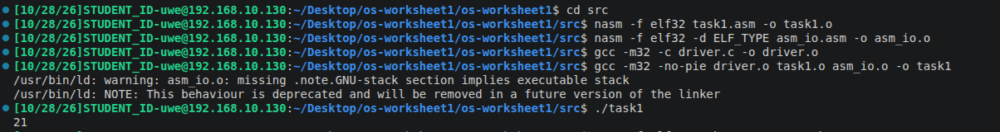
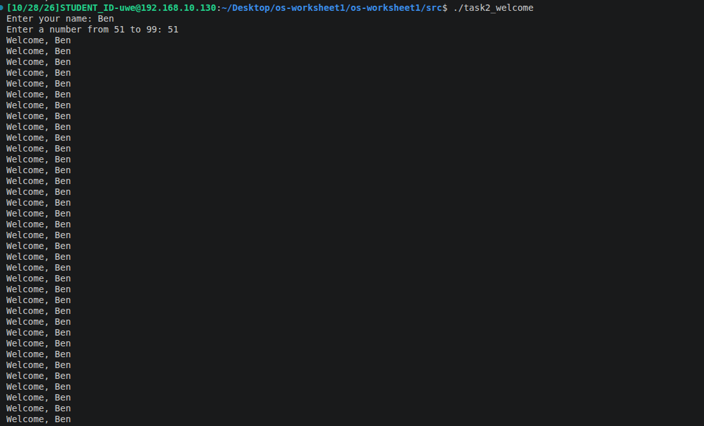
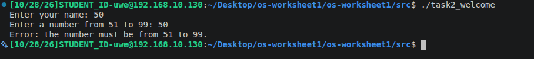

# Operating Systems - Worksheet 1

**Name:** Ben Hicks
**Student ID:** 25000896
**Module:** UFCFWK-15-2 Operating Systems

## Overview
This worksheet will explore the 32-bit x86 assembly using NASM and calling assembly from C, while also implementing conditionals and loops, and building programs with MAke.

## Repo Structure
- "Src/" Is the assembly programs, C Driver and supplied I/O files.
- "screenshots/" Will be the screenshots of the program running and results
- "README" Is this! The explanations, instructions, and testing.

## Task 1 - Adding Two Integers

### What the program does
Adds the stored numbers 15 and 6, saves the result and prints 21.

### How it works
- **Where are the numbers and results are stored:** ```Integer1``` and ```Integer2``` are stored in the ```.data``` section with the values 15 and 6. The .```bss``` section also reserves four bytes for result and resd 1.
- **How the sum is calculated:** ```mov eax, [Integer1]``` copies 15 into the EAX register. ```add eax, [integer2]``` adds 6, leaving 21 in EAX and lastly. ```mov [result], eax``` stores that answer in its memory.
- **How the result is displayed:** ```call print_int``` print the integer currently held within the EAX, which would be 21. ```call print_n1``` would then print a newline
- ***How C calls the assembly:*** ```driver.c``` declares ```asm_main``` and calls it from its function ```main```. This assembly declartion ```global asm_main``` then makes the function available to all the C drivers when the files are linked. The assembly would then return to the sum of 0 to indicate a successful completion.

### How to build and run
Run these commands inside the `src` folder via terminal:

```bash
nasm -f elf32 task1.asm -o task1.o
nasm -f elf32 -d ELF_TYPE asm_io.asm -o asm_io.o
gcc -m32 -c driver.c -o driver.o
gcc -m32 -no-pie driver.o task1.o asm_io.o -o task1
./task1
```

- The expected output would be 21


## Task 1_2 - Adding User Input

### What the program does
Asks the user for two integers, adds them together and displays the result.

### How it works
- **Displaying prompts:** `mov eax, prompt` loads the prompts address into EAX, `call print_string` prints the text until it reaches the terminating zero byte.
- **Reading input:** `call read_int` reads an integer entered by the user and places its value into EAX.
- **Storing inputs:** `mov [integer1], eax` stores the first input in memory. `mov [integer2], eax` stores the second. Each variable has four bytes reserved in `.bss`.
- **Calculating the sum:** `mov eax, [integer1]` loads the first number into EAX. `add eax, [integer2]` adds the second. `mov [result], eax` stores the sum.
- **Displaying the calculation:** `print_string` prints the messages, while `print_int` prints the numbers loaded into EAX. Putting them together would print the output of the task.

### How to build and run
Run these commands inside the `src` folder.
These reuse `driver.o` and `asm_io.o` from Task 1.

```bash
nasm -f elf32 task1_2.asm -o task1_2.o
gcc -m32 -no-pie driver.o task1_2.o asm_io.o -o task1_2
./task1_2
```

### Result
Entering `5` and `7` should display:

```text
The sum of 5 and 7 is: 12
```


## Task 2.1 - Personalised Welcome Message

### What the program does
Asks the user for their name and a number from 51 to 99. It prints a personalised welcome that many times. Numbers outside this range produce an error message.

### How it works
- **Displaying prompts:** `print_string` displays the name and number prompts using their addresses in EAX.
- **Reading the name:** `read_char` reads one character at a time into AL. Each character is stored in `name_buffer`, with ESI tracking its position.
- **Storing the name:** The buffer reserves 64 bytes. Up to 63 characters are stored, followed by a zero byte so `print_string` knows where the name ends.
- **Reading the number:** `read_int` reads an integer into EAX, which is then stored in `count`.
- **Checking the number:** `cmp`, `jle` and `jge` declines values less than OR equal to 50 and greater than OR equal to 100.
- **Repeating the welcome:** The program prints `"Welcome, "` followed by the name. `dec` reduces the count by one, and `jg` repeats the loop while the count is greater than zero.

### Code example

```nasm
cmp eax, 50
jle .invalid_count

cmp eax, 100
jge .invalid_count
```

These comparisons ensure that only numbers from 51 to 99 are accepted.

### How to build and run
Run these commands inside the `src` folder:

```bash
nasm -f elf32 -d ELF_TYPE asm_io.asm -o asm_io.o
gcc -m32 -c driver.c -o driver.o
nasm -f elf32 task2_welcome.asm -o task2_welcome.o
gcc -m32 -no-pie driver.o task2_welcome.o asm_io.o -o task2_welcome
./task2_welcome
```

### Screenshots
The first screenshot would be receiving a succesful output of the welcome task.

WHere as the second one is evidence of the output giving us an error message.
