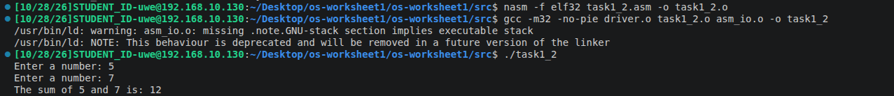

# Operating Systems - Worksheet 1

**Name:** Ben Hicks
**Student ID:** 25000896
**Module:** UFCFWK-15-2 Operating Systems

## Overview
This worksheet will explore the 32-bit x86 assembly using NASM and calling assembly from C, while also implementing conditionals and loops, and building programs with MAke.

## Repo Structure
- "Src/" Is the assembly programs, C Driver and supplied I/O files.
- "screenshots/" Will be the screenshots of the program running and results
- "Makefile" Will be the build rules.
- "README" Is this! THe explanations, instructions, and testing.

## Task 1 - Adding Two Integers

### What the program does
Adds the stored numbers 15 and 6, saves the result and prints 21.

### How it works
- Explain where the two numbers and result are stored.
- Explain how `mov` and `add` use EAX to calculate the sum.
- Explain how `print_int` displays the result.
- Explain how `driver.c` calls `asm_main`.

### How to build and run
Run these commands inside the `src` folder via terminal:

```bash
nasm -f elf32 task1.asm -o task1.o
nasm -f elf32 -d ELF_TYPE asm_io.asm -o asm_io.o
gcc -m32 -c driver.c -o driver.o
gcc -m32 -no-pie driver.o task1.o asm_io.o -o task1
./task1

- The expected output would be 21


## Task 1_2 - Adding User Input

### What the program does
Asks the user for two integers, adds them together and displays the result.

### How it works
- Explain how `print_string` displays the prompts.
- Explain how `read_int` reads a number into EAX.
- Explain how the two numbers are stored in memory.
- Explain how `mov` and `add` calculate the sum.
- Explain how `print_string` and `print_int` display the calculation.

### How to build and run
Run these commands inside the `src` folder.
These reuse `driver.o` and `asm_io.o` from Task 1.

```bash
nasm -f elf32 task1_2.asm -o task1_2.o
gcc -m32 -no-pie driver.o task1_2.o asm_io.o -o task1_2
./task1_2
```

### Result
Entering `5` and `7` should display:

```text
The sum of 5 and 7 is: 12
```

